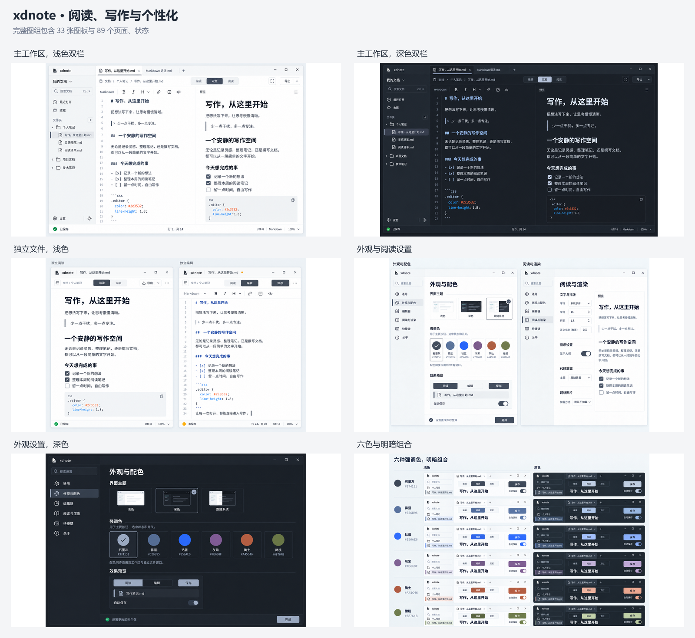

# xdnote

一款面向 Windows、macOS 和 Linux 的 Markdown 阅读与编辑桌面应用，让打开、阅读和修改本地文档保持简单。

**当前阶段：工作区基础、单文件功能原型与组件准入。** `xdnote` 已接入真实本地 Markdown 文件的打开、阅读／编辑切换、保存、另存为、外部冲突和未保存关闭确认；同一文件跨入口共用会话。独立窗口支持跟随系统／浅色／深色与六种强调色，在文档操作菜单中选择并持久化，源文和阅读使用同一主题。首轮只接收不超过 2 MiB 的严格 UTF-8 普通文件；硬链接文件采用另存为保护。构建与运行见[开发构建](docs/engineering/developer-build.md)。工作区基础原型已接入显式目录、多标签、原会话接管和编辑／阅读／双栏，详见[工作区基础](docs/engineering/workspace-foundation.md)。双栏通过[语义段落映射](docs/engineering/scroll-synchronization.md)关联两侧滚动，保持原文与撤销不变。Windows、Linux 和 macOS 已接入[受限本地图片预览与图片导入](docs/engineering/workspace-resource-foundation.md)，独立窗口导入会显式选择图片目标目录；预览支持当前文档的标题片段跳转。Windows、Linux 和 macOS 已接入工作区引用检查、相对文档链接打开／标题定位，以及预览确认的移动和引用维护；实际平台验收按各项证据独立记录。完整设置窗口、系统文件关联安装和发行包尚未完成，下文产品方向不代表全部已经实现。



本轮已制作 33 张静态图板，覆盖 89 个页面与状态，并输出对应切图、SVG 与透明 PNG 素材。设计图使用石墨灰展示，保留六种可选强调色；折光品牌与应用图标方向已获用户确认，原生平台显示尚待验证。

[浏览完整设计图](design/index.html) · [查看界面覆盖清单](docs/visual/screen-inventory.md) · [查看设计素材](design/assets/README.md)

## 产品方向

- **随手打开一个文件**：通过系统双击打开 `.md`、`.markdown`，直接进入独立阅读窗口，无需先创建或导入工作区。
- **按需开始编辑**：独立窗口在阅读与编辑间切换，主工作区提供编辑、双栏和阅读视图。
- **管理一组文档**：工作区承载文件导航和多标签，独立文件可移入工作区继续处理，同一文件的未保存内容保持连续。
- **可靠地保存**：区分未保存、保存中、保存失败与外部修改冲突；关闭和退出保护未保存内容。
- **选择自己的外观**：浅色、深色、跟随系统与六种强调色分别选择，配色在主界面、独立窗口和设置窗口中保持一致。

需求来源、首版边界和后续能力见[产品需求](docs/product/requirements.md)。

## 从哪里开始

| 我想了解 | 入口 |
| --- | --- |
| 产品定位、首版范围 | [产品需求](docs/product/requirements.md) |
| 双击打开、多窗口、保存与关闭行为 | [交互规格](docs/product/interaction-spec.md) |
| 工作区图片、文档链接与移动维护 | [资源与链接规格](docs/product/workspace-resources.md) |
| 配色、主题和其他偏好 | [设置规格](docs/product/settings.md) |
| 颜色、密度、组件和窗口约定 | [视觉规范](docs/visual/design-system.md)、[视觉参数](docs/visual/tokens.json)、[窗口清单](docs/visual/window-registry.json) |
| 已确认的技术方向、模块契约与准入条件 | [技术架构](docs/engineering/architecture.md) |
| 构建桌面基础工程与运行组件验证 | [开发构建](docs/engineering/developer-build.md) |
| 跨屏缩放、窗口尺寸与恢复 | [窗口几何契约](docs/engineering/window-geometry.md) |
| 阶段顺序与验收要求 | [开发路线](docs/planning/roadmap.md)、[验收规格](docs/qa/acceptance.md) |
| Issue、分支、PR 与 CI | [产研流程](docs/engineering/workflow.md)、[贡献指南](CONTRIBUTING.md) |
| 查看设计原稿和素材 | [设计材料](design/README.md)、[高保真图](design/hifi/README.md)、[素材交付](docs/visual/asset-handoff.md) |

完整索引见 [docs/README.md](docs/README.md)。

产品预览使用 Rust 全局语义模型＋Qt 原生按需布局，已移除 WebEngine 和浏览器运行配置。[语义模型](docs/engineering/native-preview-model.md)提供只读块树，[原生阅读控件](docs/engineering/native-preview-view.md)统一承载工作区和独立窗口；平台、真实读屏和发行验证按各自证据记录。[替代方案评估](docs/engineering/preview-alternatives.md)保留候选依据。

## 仓库结构

```text
xdnote/
├── README.md
├── AGENTS.md                  # 协作与材料维护约定
├── apps/desktop/              # 单文件功能原型与独立的组件准入窗口
├── crates/markdown/           # Rust 只读解析服务
├── cmake/                    # 桌面构建定义
├── scripts/                  # 准备、构建与检查入口
├── tools/                    # 固定依赖清单
├── docs/
│   ├── product/               # 需求、交互、设置与工作区资源
│   ├── visual/                # 视觉规则、参数、窗口登记
│   ├── engineering/           # 实施架构与可复用工程实践
│   ├── planning/              # 阶段与退出条件
│   └── qa/                    # 可复用验收规格
├── design/
│   ├── hifi/v2/              # 当前完整图组、总览和缩略图
│   ├── assets/ui-v2/         # 矢量、透明 PNG 与原图参考切片
│   ├── assets/palettes/      # 前期配色候选样张
│   ├── brand-proposals/      # 已选品牌及其他候选方向
│   ├── sources/              # 图像提示词、回执与素材导出源
│   ├── index.html            # 静态材料画廊
│   └── manifest.json          # 材料身份、尺寸、摘要与用途
└── experiments/              # 与产品实现明确区分的技术验证源码
```

应用目录随真实实现建立，不预建空模块。C++ 会话持有唯一 Scintilla 原文与撤销，Rust 提供只读解析。单文件窗口使用 QWidget 与原生平台外框；独立的内存准入窗口继续验证 QQuickWidget 混合承载。依赖及实际构建入口见[开发构建](docs/engineering/developer-build.md)，文件保证和限制见[保存闭环](docs/engineering/file-save-workflow.md)，其他平台与组件继续按[架构准入](docs/engineering/architecture.md)逐项验证。

技术验证入口：[Qt 文档与窗口试验](experiments/qt-document-spike/README.md) · [Scintilla 文本缓冲区试验](experiments/scintilla-buffer-spike/README.md) · [Markdown 解析候选试验](experiments/pulldown-markdown-spike/README.md)。这些均不是产品实现。

## 维护方式

产品行为以 `docs/product` 为准，精确视觉值以 `docs/visual` 为准，位图用于布局和风格参考。设计图中尚未定义的导出、收藏等入口不自动进入首版承诺。

设计原稿、素材和提示词是持久输入，保留在 `design`；不在源码目录保存设计导出 ZIP。构建、运行截图、测量与检查报告进入忽略的 `build/`、`target/` 或 `dist/`。任务进度使用 GitHub Issues，文档维护可复用规则，不累积执行流水账。

平台目标为 Windows 10 1809+ x86_64、macOS 13+ x86_64／arm64，以及以 Ubuntu 22.04 LTS 为最低参考的 Linux x86_64（GNOME，Wayland／X11）。这些是后续开发和验证基线，尚非产品兼容性通过记录；详见[平台目标](docs/engineering/platform-support.md)。签名与发行策略仍在对应阶段确定。

## 许可范围

本仓库的自有软件代码（包括工具脚本和技术试验代码）采用 [Apache-2.0](LICENSE)；自有文档与原创设计素材采用 [CC BY 4.0](LICENSES/CC-BY-4.0.txt)。设计内容即使嵌入代码，仍按设计许可处理；第三方内容按其自身条款处理。适用范围、署名及品牌权利边界见[许可范围与依赖](docs/engineering/licensing.md)，已核对的依赖与上游许可文本见[第三方许可记录](THIRD_PARTY_NOTICES.md)。
