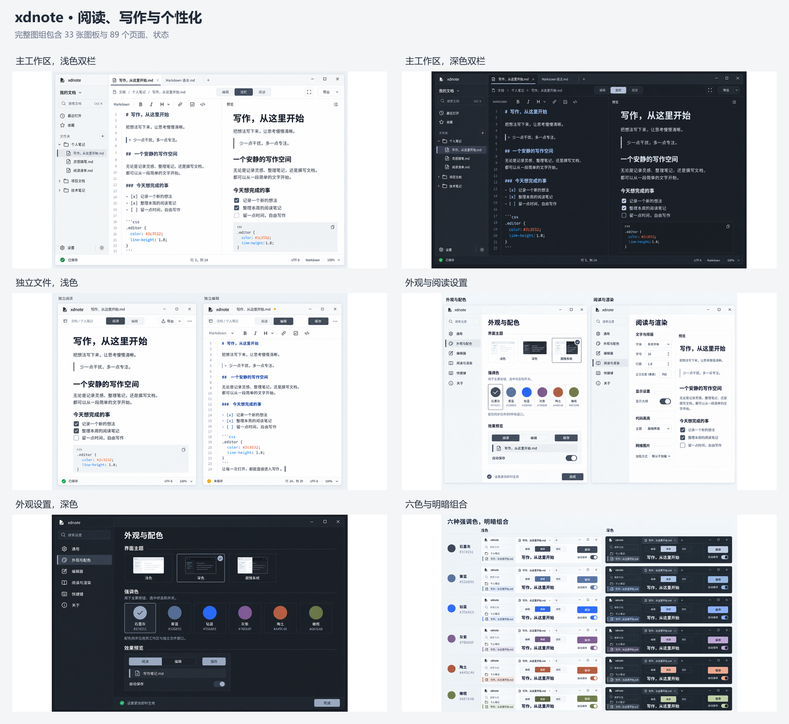

# 设计材料

当前采用图组包含 **33 张图板、89 个页面与状态**，使用 xdnote 产品名。材料覆盖主工作区、独立文件、六类设置、导航与编辑辅助、菜单、文件闭环、异常、兼容、导出和跨平台交接，均为静态设计。

用户已授权以当前图组为开发基线；实施同时遵循产品规格和共享视觉参数，后续遇到实质问题再讨论调整。项目自有说明文档与原创设计素材采用 [CC BY 4.0](../LICENSES/CC-BY-4.0.txt)，范围和署名规则见[许可说明](../docs/engineering/licensing.md)。

[打开完整画廊](index.html) · [重点界面](hifi/v2/featured.png) · [全部总览](hifi/v2/overview.png) · [覆盖清单](../docs/visual/screen-inventory.md)

## 当前采用

| 材料 | 入口 |
| --- | --- |
| 浅色／深色工作区 | [浅色](hifi/v2/boards/01-workspace-light.png)、[深色](hifi/v2/boards/02-workspace-dark.png) |
| 独立阅读与编辑 | [浅色](hifi/v2/boards/05-standalone-light.png)、[深色](hifi/v2/boards/06-standalone-dark.png) |
| 标题栏高度对照 | [40 与 48 逻辑像素对照图](hifi/v2/comparisons/titlebar-height.png)；当前应用自绘标题栏统一建议为 48 |
| 窗口标题栏对照 | [主工作区与独立窗口](hifi/v2/comparisons/standalone-header-alignment.png)，按原图比例比较 |
| 设置 | [通用与编辑器](hifi/v2/boards/11-settings-general-editor.png)、[外观与阅读](hifi/v2/boards/12-settings-appearance-reader.png)、[快捷键与关于](hifi/v2/boards/13-settings-shortcuts-about.png)、[深色](hifi/v2/boards/14-settings-dark.png) |
| 全部页面与状态 | [图板索引](hifi/README.md)、[机器可读目录](sources/ui-suite-v2.json) |
| 素材 | [使用说明](assets/README.md)、[精确配色图册](assets/ui-v2/previews/accent-matrix.png)、[素材清单](assets/ui-v2/manifest.json) |
| 品牌候选 | [三款评审图](brand-proposals/README.md)；折光双色版已确认 |

石墨灰是当前展示默认值；六种强调色均保留，明暗与强调色分别选择。准确颜色和逻辑尺寸见[视觉参数](../docs/visual/tokens.json)，不能由 PNG 物理尺寸反推组件几何。

## 目录与用途

| 目录 | 内容 |
| --- | --- |
| `hifi/v2/boards` | 本轮完整图组；每张图使用稳定文件名保留最新版本 |
| `hifi/v2/comparisons` | 待决设计参数的等比例对照图 |
| `hifi/v2/thumbnails` | 静态画廊缩略图 |
| `assets/ui-v2` | SVG、透明 PNG、原图参考切片、预览与来源摘要 |
| `brand-proposals` | 三款品牌评审图及生成提示词；折光双色方向已确认 |
| `sources` | 逐图提示词、修订回执、切图与矢量生成源 |
| `assets/palettes` | 早期六色候选样张 |

逐界面切片和组件局部是设计参考，记录原图像素矩形；独立图标、按钮底形与状态素材另有可编辑源，文字不烘焙进通用控件。详细使用方法见[交付说明](../docs/visual/asset-handoff.md)。

33 张当前图板、摘要和提示词记录见[材料清单](manifest.json)与[来源说明](sources/README.md)。完整窗口是位图设计，并非可编辑 Figma 文件；折光品牌 SVG、PNG、ICO 与 ICNS 已按确认方向制作，原生平台效果尚待验证。

本次工作只制作设计输入。P1 界面不自动进入首版承诺，原生窗口、平台关联和实际行为仍待研发阶段处理。
