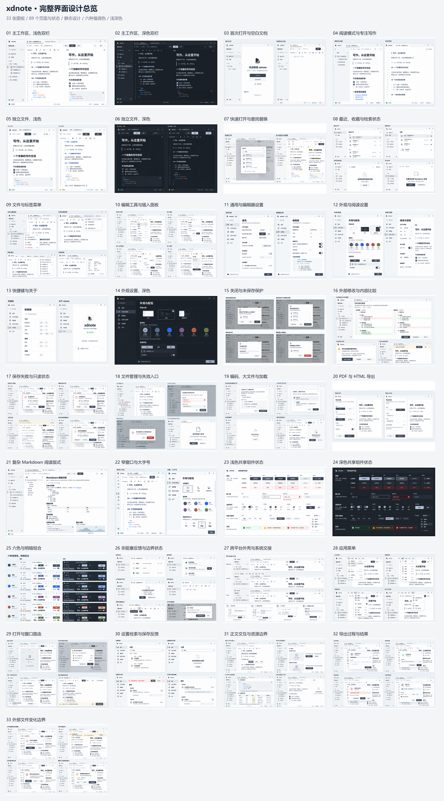

# 高保真设计图

本轮共 33 张采用图板、89 个页面与状态，按[完整画廊](../index.html)或[覆盖清单](../../docs/visual/screen-inventory.md)逐项查看。浅深色与六种强调色遵守同一套视觉参数，图像不是可运行应用。

## 图组内容

| 图板 | 范围 |
| --- | --- |
| 01–06 | 浅深色主工作区、欢迎与空白、阅读／专注、独立文件阅读与编辑 |
| 07–10 | 快速打开、查找替换、最近与收藏、空态、文件／标签菜单、插入面板 |
| 11–14 | 通用、编辑器、外观、阅读、快捷键、关于及深色设置 |
| 15–19 | 关闭保护、保存中、外部修改、比较、保存失败、只读、文件管理、编码和大文件 |
| 20–22 | PDF／HTML 导出、复杂 Markdown、紧凑布局与大字号 |
| 23–27 | 明暗组件、六色组合、提示与焦点、跨平台窗口与系统交接 |
| 28–33 | 应用菜单、文件路由、设置失败、选区与图片、导出过程、外部删除／占用／编码确认 |

查看原图时以[目录](../sources/ui-suite-v2.json)中各图板的 `path` 为准。每张图只保留稳定文件名下的最新图片；提示词和文本来源记录另行保留。

[标题栏 40 与 48 逻辑像素对照图](v2/comparisons/titlebar-height.png)按相同界面与文字行高绘制，仅用于比较尺寸，不代表原生窗口实测或新增采用图板。当前建议使用 48，路径已移至下方工具栏。

交互语义以[产品文档](../../docs/README.md)为准，精确几何和颜色以[参数](../../docs/visual/tokens.json)为准。菜单快捷键为相应平台的设计示例，系统文件选择器与装饰由平台决定。

切图和独立素材见[素材说明](../assets/README.md)，来源与摘要见[材料清单](../manifest.json)。
