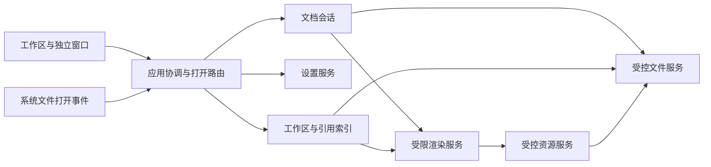

# 技术架构与实施基线

**状态：架构方向已确认，单文件功能原型已接入真实文件，具体能力按准入条件验证。** 用户已确认本页的职责分工与实施路线。Qt 桌面框架、单会话原文与撤销所有权、独立保存服务和统一构建入口作为研发基线；Scintilla、Qt Quick 的具体承载和非 Chromium 预览仍须满足下文准入条件。默认 `xdnote` 提供工作区基础及独立文件的打开、编辑、保存、冲突与关闭确认，基础工作区支持原会话接管，边界见[工作区基础](workspace-foundation.md)；内存准入窗口独立保留；源码、依赖与入口见[开发构建](developer-build.md)，保存保证和范围见[保存闭环](file-save-workflow.md)，尚无安装或发行包。产品约束见[需求](../product/requirements.md)，行为见[交互规格](../product/interaction-spec.md)，工作区资源见[图片与文档链接](../product/workspace-resources.md)。

## 已确认的架构取舍

| 决策 | 实施选择与依据 | 代价、准入与调整条件 |
| --- | --- | --- |
| 桌面框架与语言边界 | 采用 Qt 桌面路线，Qt Quick／QML 优先负责共享界面，C++ 负责桌面协调、会话与平台接口，Rust 负责解析等独立服务；当前准入窗口用 QWidget 容器和 QQuickWidget 接入公开控件端口 | 组合承载不代表主界面视觉验收。若影响已验收外观或交互，记录可复现限制并与用户讨论；版本与实际实现边界见开发构建 |
| 文本与撤销权威 | C++ `DocumentSession` 持有唯一编辑器文档及其撤销历史，保存和解析仅接收不可变快照 | Rust 服务不维护另一份可写正文。编辑器接口暴露受控句柄，不使窗口或 QML 拥有文档寿命 |
| 原文编辑器 | 以 Scintilla 的完整文档和公开接口作为优先实施路线；已有缓冲区试验能区分普通换行与字面 U+2028／U+2029 | 必须解决 Qt 承载、组合输入及无障碍接口缺口。内部 `CellBuffer` 试验不直接移入产品，不以字符保真代替控件验收 |
| Markdown 解析 | 采用 Rust 的 pulldown-cmark 路线，明确 CommonMark 加表格、任务列表、删除线扩展，保留原文范围 | 正式版本及特性随工程锁定；原始 HTML 转义，其他扩展不自动加入首版。解析事件不等于受控预览或精确显示定位 |
| 预览承载 | 明确禁止 Chromium；采用 Rust 全局语义模型＋Qt 原生按需布局主路线，litehtml 核心＋自有 Qt 适配保留备选，继续共用方言、版本和资源授权 | [语义模型](native-preview-model.md)与[原生阅读控件](native-preview-view.md)已接入产品，不链接 WebEngine；整进程树资源预算、长文、样式、复制与无障碍分别验证，候选依据见[预览方案评估](preview-alternatives.md) |
| 文件与保存 | 独立文件服务封装平台身份和替换原语，统一冻结快照、核验、同目录暂存、提交与结果分类 | 不将检查后替换当作跨进程比较交换；普通本地文件、链接、特殊卷分别验证，未确认结果不得显示已保存 |
| 进程与工具链 | 单桌面主进程管理多窗口；采用 CMake／Ninja 与 Cargo，准备、构建、测试、打包分阶段，本地与 CI 共用入口 | 第二次启动只转发结构化打开意图；解析是否独立子进程取决于取消与隔离验证。具体版本、包类型和性能预算未锁定 |

依据包括现有 [Qt 文档试验](../../experiments/qt-document-spike/README.md)、[Scintilla 试验](../../experiments/scintilla-buffer-spike/README.md)、[解析试验](../../experiments/pulldown-markdown-spike/README.md)、[Scintilla 文档接口](https://www.scintilla.org/ScintillaDoc.html#Document)、[pulldown-cmark 说明](https://pulldown-cmark.github.io/pulldown-cmark/)和 [Qt 原生文本布局](https://doc.qt.io/qt-6.8/qtextlayout.html)。各试验的合成输入、离屏、私有接口或受限夹具结果仍按原边界解释。Qt 文档路径已经暴露字面段落分隔符的保真问题，不能直接作为原文权威；Scintilla 的 Qt 控件尚有辅助功能与 Qt Quick 集成缺口，因此保留明确准入任务，而不是宣称已可投入产品。

Markdown 编辑的输入法、撤销栈和渲染布局围绕本产品需求验证。依赖版本、安装包、字体和许可依据本项目实际内容核验。不为分层提前创建空目录、大量空 crate 或多套并行编辑与渲染实现。

## 逻辑职责

以下是完整产品的职责边界，只有开发构建中列出的基础模块已开始实现，其余不是已经存在的模块目录。

| 责任 | 拥有的状态／能力 | 不应承担 |
| --- | --- | --- |
| 界面与平台适配 | 控件、输入法、窗口、系统菜单、关联打开意图 | 直接决定文件冲突覆盖、修改领域保存状态 |
| 应用协调 | 文档查找、打开路由、窗口承载、设置变更与退出流程 | 各窗口维护独立可覆盖的同文件缓冲区 |
| 文档会话 | C++ 协调唯一原文与撤销、文档身份、文本版本、保存基线、编码与换行 | 窗口寿命、控件布局、平台安装与发行 |
| 文件服务 | 读取、监测、身份核验、暂存、提交与失败分类 | 渲染 HTML、解释 UI 文案 |
| 渲染服务 | 明确方言的解析与展示结果、版本关联 | 任意系统文件读取、进程执行、保存原文件 |
| 设置服务 | 有版本的配置校验、持久化与全局通知 | 保存正文、替代文档撤销栈 |
| 工作区与引用索引 | 显式授权根目录、图片导入规划、链接关系、来源版本和移动影响分析 | 私有资料库替代 Markdown、把索引命中当作文件访问授权 |

每个文档只有一个内容权威：`DocumentSession` 持有编辑器文档和唯一撤销栈，编辑适配层在界面线程执行修改。选区与滚动位置属于视图状态，接管时随会话恢复；输入法预编辑是临时状态，未经提交不得进入可保存快照。Rust 解析器、引用索引和预览只持有带版本的只读派生数据。窗口切换、阅读切换及预览生成均不重新构造可写正文。

Qt Quick 文档试验发现，已缓存的辅助功能接口可能继续引用替换前的文档；整段辅助功能写入也可能绕过只读并清除撤销。现有适配试验通过会话持有文档、事务固定生命周期、拒绝重入替换和延后关闭处理这些路径，Windows 单编辑器值模式夹具还验证了原生拒绝返回；私有接口和完整辅助技术集成的边界见[试验说明](../../experiments/qt-document-spike/README.md#重要限制)。这些结果作为选型依据，不表示正式产品已经采用该控件或原生桥。

编辑命令须返回明确结果，所有入口共同执行只读、组合输入、事务状态和撤销约束；平台适配必须将拒绝映射为平台可识别的失败并提供可访问原因。关闭期间停止接受新写入，当前事务结束前保持文档存活；原生接口缓存持有会话弱引用，销毁后返回不可用。文档替换通过会话协调，不能在同步回调中直接释放或重绑正在使用的文档。

## 共享界面组件约束

后续实现应为跨窗口出现的同类公共部分提供共享组件或共享样式与布局定义，并统一读取[视觉参数](../visual/tokens.json)；顶部栏、窗口操作、状态栏／页脚、标签、图标和基础控件的范围与一致性规则见[设计系统](../visual/design-system.md#跨界面公共组件一致性)。变更共享定义时检查所有实际使用它的界面，避免按页面复制后各自漂移；没有该组件的界面不必新增。

因窗口职责、响应式布局或平台原生装饰确需区分时，先在规格中说明组件或容器变体、适用范围及共享部分，再实现和验证。窗口操作由系统提供时尊重平台原生行为；应用自绘时同平台同类窗口使用统一实现。组件的键盘焦点外框仍遵循[控件交互规则](../product/control-interactions.md)，不以复用为由改变焦点或选中语义。

跨屏、原生尺寸约束和几何恢复由 C++ 桌面层统一协调，契约见[窗口几何](window-geometry.md)。正常逻辑客户区、原生设备外框和用户偏好／临时适配分别管理，界面与原生层不能同时按不同倍率改写尺寸。跨屏只更新几何与采样上下文，不改变文档会话、原文或撤销；具体实现与混合 DPI 验收仍待执行。

## 文档与异步边界

`DocumentSession` 至少包含稳定 `DocumentId`、来源身份、源文版本 `TextRevision`、可比较的内容／撤销状态 `ContentStateId`、最近确认的保存基线、编码／BOM／换行和渲染代次。`TextRevision` 对已提交编辑及撤销／重做单调递增，用于拒绝过期结果；dirty 依据当前内容状态与保存基线比较，不以单调版本号相等替代。撤销回到已保存状态可以恢复 clean；保存期间继续输入时，成功回执只记录对应快照，不能将当前编辑位置直接设为保存点。新建未命名文档有独立 ID，首次保存后再绑定文件身份。

保存和渲染都携带文档 ID、请求 ID、文本版本，迟到回执不能作用到复用窗口中的另一文档。后台解析只返回纯结果，由 UI 线程更新视觉状态；组合输入、焦点和原生窗口操作遵守平台线程约束。退出与关闭必须等待所需终态，不能以断开回调代替正确的资源生命周期。

同用户会话由单桌面主进程持有会话表与多窗口，第二次启动通过本地 IPC 转发打开请求并获得接收结果。IPC 限定本用户访问、协议版本、长度、路径数和确认时限，使用结构化参数，不拼接命令解释器；具体限额由本项目验证确定。原生预览不建立浏览器进程；解析任务是否另设工作进程须证明取消、回收和资源限制有效，不能把普通子进程称为操作系统沙盒。

文件移动、另存为、工作区关闭和授权变化即使没有改动正文，也会改变资源基准。相关回执另带路径／授权代次；旧预览、图片请求和引用分析不得继续使用旧基准。跨语言边界使用有长度和所有权约定的 UTF-8 数据及明确错误，不传递 QObject、编辑器内部指针或可跨线程修改的文档引用；具体桥接库随正式工程验证。

## 模块接口与线程归属

以下是完整产品的语义接口，不是现有函数、导出 ABI 或目录结构清单。已开始的基础接口和限制见[开发构建](developer-build.md)；接口参数随实现固定，但身份、版本和结果语义不得省略。

| 入口 | 输入与输出 | 归属与约束 |
| --- | --- | --- |
| `OpenIntent`／`SessionRegistry` | 用户打开意图、目标容器和可选片段 → 已有或新建 `DocumentId`、逐项错误 | 界面线程协调；文件身份探测异步完成，重复打开不得重读覆盖 dirty 会话 |
| `EditorAdapter.execute` | 文档、预期版本、编辑命令 → 已应用、未变化或明确拒绝 | 界面线程；键盘、菜单、批量引用更新与辅助功能遵循相同只读、组合输入和撤销契约 |
| `DocumentSession.snapshot` | 文档及请求目的 → 不可变源文、内容状态、文本与路径代次 | 在组合输入与事务边界核对；成功快照可供后台使用，不能跨线程读取活动编辑缓冲区 |
| `FileService.read`／`save` | 授权目标及读取基线／保存快照 → 内容与身份／提交结果 | 后台 I/O；按文档串行提交，结果为成功、冲突、提交前失败或提交不确定 |
| `MarkdownService.parse` | 同一快照、解析配置和请求代次 → 事件、块映射、引用及诊断 | Rust 服务；不打开源文中的资源，保留 UTF-8 范围，转换为视图位置时校验同一版本 |
| `PreviewHost.present` | 派生模型、当前样式和版本 → 展示完成或失败 | 界面承载；仅接收当前结果，文档内容不能获得原生文件或编辑接口 |
| `ResourceService.open` | 文档／工作区授权、资源基准代次、解析后的相对目标 → 有限资源流或拒绝 | 后台核对实际打开对象；私有资源标识仅用于预览，不写入 Markdown |
| `AssetService.import` | 图片输入、受管目录、插入位置及文档版本 → 已核验资源与引用插入结果 | 先安全落盘再通过编辑命令插入；正文撤销不自动删除共享资源 |
| `ReferenceIndex`／`WorkspaceOperations` | 有版本的文档集合及路径变更意图 → 引用关系、影响计划和逐项执行结果 | 后台分析，界面线程确认会话修改；索引不完整或预期版本失效时拒绝宣称全量修复 |

文件打开和保存的系统调用由文件服务及平台适配统一封装；Rust 可承担编码、摘要和纯分析，不另建一条绕过身份与权限核验的写盘路径。设置持久化仍遵循[设置契约](../product/settings.md)。

## 关键时序

| 场景 | 顺序与完成条件 |
| --- | --- |
| 打开 | `OpenIntent` → 授权与文件身份核验 → 查会话 → 激活已有会话，或读取基线并建立新会话 → 发布版本化预览；失败逐项反馈 |
| 独立窗口接管 | 固定原会话 → 组合输入／编辑事务期间延后 → 准备目标容器 → 迁移承载并恢复视图状态 → 确认可用后释放原容器；失败保留原窗口与原文 |
| 保存 | 捕获已提交内容快照 → 核验文件基线 → 同目录暂存与刷新 → 最后核验及平台提交 → 核对实际结果 → 更新快照保存基线；较新的修改仍为 dirty |
| 外部冲突 | 监测或保存发现变化 → 标记 conflict 并暂停自动写入 → 保留内存修改 → 用户选择保留、另存为或重新载入；放弃当前修改需确认 |
| 关闭／退出 | 拒绝新的修改与迁移 → dirty 时询问保存、放弃或取消 → 等待活动事务和必要保存终态 → 取消或隔离派生任务 → 失效原生弱引用 → 释放会话；取消、冲突和失败不得提前销毁正文 |
| 图片与路径变更 | 核对工作区授权 → 规划导入或入站／出站引用变化 → 展示影响并确认需要的磁盘修改 → 重新核验版本与目标 → 经统一文件／编辑入口执行 → 刷新路径代次与索引，逐项报告失败 |

关闭确认期间保留可继续使用的原会话；取消后恢复正常编辑。工作区关闭只移除其授权和索引上下文，仍由其他窗口持有的会话按照关闭契约处理，不能因销毁文件树而丢弃未保存正文。

## 文件保存与竞争

保存由一个服务完成读取基线核验、编码、同目录暂存、刷新、替换和完成回执。保存结果区分提交前失败、已提交、结果不确定，界面依据实际状态恢复，不伪造“失败所以一定未写入”。

写前身份与内容版本检查能发现外部变化，但“检查后 rename”不是跨进程原子比较交换。应用自己的互斥只能协调自身，不能阻止其他程序同时写入。技术验证必须明确：

- 各平台使用的替换原语、可观察竞争窗口和失败语义。
- 普通本地文件、符号链接、硬链接、只读、权限变化和网络卷的适用范围。
- 原文件权限、文件身份及目录项替换的处理，以及提交与掉电持久性的区别。
- 保存成功后自身监测事件的去重，和真正外部编辑事件的区别。

发现无法保护的目标或竞争时保留内存修改，暂停自动保存并让用户处理，不以静默覆盖作为通用回退。不得承诺尚未验证的跨进程零竞态或任意文件系统掉电安全。

## Markdown 与内容承载

产品预览不得使用 Chromium，也不能通过更换包装层或改用 Chromium 系统运行时绕过此约束。原生 Qt 富文本、有界布局及轻量排版库的取舍见[预览方案评估](preview-alternatives.md)；评估和当前旧实现的迁移分别记录，不把候选试验当成产品替换交付。

资源准入须统计整个进程树，分别说明私有提交、工作集、共享页和采样范围；仅主进程或孤立工作进程的 RSS 不足以认定整应用内存通过。布局缓存必须同时考虑块数量、字节、图片解码与单个超大块；只限制缓存条目数不能保证总体内存。段落、列表、表格、代码的全局语义由同一个解析配置产生，不能为了分块而独立重解析源文切片、丢失引用定义或重建原文。

pulldown-cmark 的实现须固定并测试 CommonMark 基础语法，以及表格、任务列表和删除线扩展；标题、列表、引用、围栏代码、图片、链接与代码中的伪链接使用同一语料。其他扩展默认关闭，原始 HTML 转义展示，不把这些选择称为完整 GitHub 渲染兼容。源文位置、标题锚点和资源目标由同一解析配置生成，引用改写不得对整个文档重新序列化。现有 Rust 原生解析集成、候选取舍、全文解析与取消限制见 [Markdown 解析方案](markdown-parsing.md)。

非 Chromium 预览须统一样式、块定位与资源入口，测量长文更新、选区、辅助功能、内存和包体积，并核对三平台及最低系统部署。原文编辑不发生在预览中。复制、链接和标题定位通过受控且带版本的原生接口执行；文档内容不能获得任意文件或编辑权限。HTML 仅可作为受控中间表示，不意味着需要浏览器或允许执行脚本；若使用轻量 HTML 排版器，仍须检查其所有资源回调与派生输出限制。不同时维护两套完整预览产品。

内容边界：

- 原始 HTML 转义；不执行文档内脚本、事件属性与任意样式导入。
- 外部链接仅在用户主动点击后交给系统允许的浏览器；`javascript:` 和未批准自定义协议不执行。
- 本地图片由受控资源服务解析。显式打开工作区后可在该授权根内解析相对引用，包括合法的父目录分量；独立窗口默认上下文为文档目录。实际打开对象须仍在授权范围内，不能只凭词法路径或 `canonicalFilePath` 放行中间链接／重解析点。具体管理与越界反馈见[工作区资源契约](../product/workspace-resources.md)。
- 网络图片默认不自动加载，文档打开不隐式联系第三方；远程内容加载若后续加入，单独定义授权和缓存策略。
- 解析、资源尺寸和复杂度有可取消的上限。具体额度通过样本测量决定，不能因文件很小就忽略解析工作量。

## 构建与交付的后续约定

正式工程采用 CMake／Ninja 与 Cargo，建立真实统一入口，将环境检查、显式准备、构建、测试、打包和验证分阶段执行。具体 Qt、Scintilla、Rust、C++ 编译器、桥接库及随包内核版本在满足平台和准入条件后锁定，不直接继承试验版本；入口尚未实现前不列出虚构构建命令。开发允许未提交修改；发行候选绑定明确源码与依赖身份。依赖下载、Qt SDK、编译器和安装工具不由普通构建静默获取。

Windows 的应用目录内运行库与 Qt 样式裁剪以本产品实际导入和依赖清单为依据。软件图形回退库不能只因体积大而删除，裁剪后要在脱离 SDK 搜索路径的独立目录实际运行。

macOS、Windows 和 Linux 分别确定支持范围、安装包、文件关联与签名策略，按本项目平台目标和交付需求验证。发行许可、来源、原生安装及视觉验收各自需要材料，构建成功不能代替这些结论。

最低系统、64 位 CPU 架构及 Linux 图形环境以[平台目标](platform-support.md)为准；正式工具链和随包依赖须满足这些目标，并分别记录实际验证状态。项目自有代码、文档与设计的许可见[许可说明](licensing.md)，第三方分发义务仍按最终交付清单核对。

## 实施准入与后续决策

| 项目 | 已确认边界 | 仍需取得的证据 |
| --- | --- | --- |
| 框架与模块边界 | Qt 桌面与上述分工 | 编辑器实际承载、三平台窗口与文档闭环、桥接和固定版本 |
| 文本与撤销 | 单会话持有唯一编辑器文档与撤销，Scintilla 优先 | 字符保真、组合输入、接管、辅助功能读取／写入／拒绝及生命周期；不得禁用辅助功能换取通过 |
| 解析与预览 | pulldown-cmark 与固定扩展，禁止 Chromium，Qt 原生承载，平台与发行验收分别记录 | 全局块语义、实际排版、源文定位、资源授权、真实取消与整进程树预算，依赖许可与部署 |
| 保存与文件身份 | 独立服务、快照及分类结果 | 平台提交原语、权限／元数据、文件身份、竞争、链接与文件系统适用范围 |
| 工作区资源 | 普通文件、相对路径、重建式索引、确认后维护引用 | 图片导入、实际对象授权、引用定位、dirty 会话、移动竞争与部分失败；产品任务分别为 [#50](https://github.com/xiaodaozhi/xdnote/issues/50)、[#51](https://github.com/xiaodaozhi/xdnote/issues/51) |
| 工具链与部署 | CMake／Ninja、Cargo 和统一分阶段入口 | 固定版本、实际依赖、四种平台／架构输出、干净运行目录、来源清单与稳定汇总 CI 检查 |

本页取代原先未决的职责与路线表述，保持唯一现行架构。后续改变选择时更新理由、依据、代价与调整条件；一次试验不自动关闭研究 Issue 或完成产品验收。按用户安排，macOS／Linux 实机、真实输入法和屏幕阅读器先保留待执行项，推进可自动化部分；它们仍是对应平台验收门槛。阶段顺序见[开发路线](../planning/roadmap.md)。
