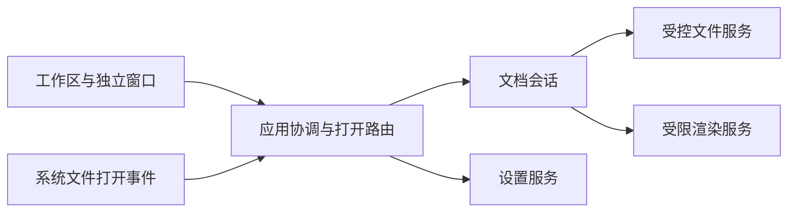

# 架构草案

**状态：待技术验证。** 本文约束职责和需要回答的问题，不表示已经采用 Qt、Rust、某个 Markdown 库或某种渲染内核。产品约束见[需求](../product/requirements.md)，行为见[交互规格](../product/interaction-spec.md)。

## 候选路线

把 xdzip 当前使用的 Qt Quick／QML、薄 C++ 桌面适配与独立 Rust 核心作为优先验证的候选，复用分层、共享控件和本地／CI 同入口的经验。xdzip 的 Qt 版本与工具链只是它自己的已锁定输入，不直接成为 xdnote 的版本要求。

Markdown 编辑的输入法、撤销栈和渲染布局与压缩包浏览不同。先以真实文件闭环验证缓冲区所有权、渲染承载和跨平台成本，再记录最终决策。不能以“另一项目已经使用”跳过本产品的验证，也不为了分层提前拆出大量空 crate。

## 逻辑职责

以下是职责边界，不是已经存在的模块目录。

| 责任 | 拥有的状态／能力 | 不应承担 |
| --- | --- | --- |
| 界面与平台适配 | 控件、输入法、窗口、系统菜单、关联打开意图 | 直接决定文件冲突覆盖、修改领域保存状态 |
| 应用协调 | 文档查找、打开路由、窗口承载、设置变更与退出流程 | 各窗口维护独立可覆盖的同文件缓冲区 |
| 文档会话 | 文档身份、文本版本、保存基线、编码、换行、撤销归属 | GUI 类型、平台安装与发行 |
| 文件服务 | 读取、监测、身份核验、暂存、提交与失败分类 | 渲染 HTML、解释 UI 文案 |
| 渲染服务 | 明确方言的解析与展示结果、版本关联 | 任意系统文件读取、进程执行、保存原文件 |
| 设置服务 | 有版本的配置校验、持久化与全局通知 | 保存正文、替代文档撤销栈 |

每个文档只有一个内容权威。若最终采用 Qt 编辑组件与 Rust 服务，必须先决定文本、选区、撤销栈与版本号由谁拥有，如何传播增量／快照和处理组合输入。不能让 UI 文本模型和另一份可写核心缓冲区各自认定为最新。

## 共享界面组件约束

后续实现应为跨窗口出现的同类公共部分提供共享组件或共享样式与布局定义，并统一读取[视觉参数](../visual/tokens.json)；顶部栏、窗口操作、状态栏／页脚、标签、图标和基础控件的范围与一致性规则见[设计系统](../visual/design-system.md#跨界面公共组件一致性)。变更共享定义时检查所有实际使用它的界面，避免按页面复制后各自漂移；没有该组件的界面不必新增。

因窗口职责、响应式布局或平台原生装饰确需区分时，先在规格中说明组件或容器变体、适用范围及共享部分，再实现和验证。窗口操作由系统提供时尊重平台原生行为；应用自绘时同平台同类窗口使用统一实现。组件的键盘焦点外框仍遵循[控件交互规则](../product/control-interactions.md)，不以复用为由改变焦点或选中语义。

## 文档与异步边界

`DocumentSession` 至少包含稳定 ID、来源身份、源文版本、最近已保存版本、编码／换行、修改状态和渲染代次。新建未命名文档有独立 ID，首次保存后再绑定文件身份。

保存和渲染都携带文档 ID、请求 ID、文本版本，迟到回执不能作用到复用窗口中的另一文档。后台解析只返回纯结果，由 UI 线程更新视觉状态；组合输入、焦点和原生窗口操作遵守平台线程约束。退出与关闭必须等待所需终态，不能以断开回调代替正确的资源生命周期。

同用户会话的单主进程与本地打开请求转发是候选实现。多窗口并不要求多个正常产品进程。若采用 IPC，限定本用户访问、版本、长度、路径数和确认时限，使用结构化参数，不拼接命令解释器；具体限额由 xdnote 自己验证，不复制 xdzip 的数字。

## 文件保存与竞争

保存由一个服务完成读取基线核验、编码、同目录暂存、刷新、替换和完成回执。保存结果区分提交前失败、已提交、结果不确定，界面依据实际状态恢复，不伪造“失败所以一定未写入”。

写前身份与内容版本检查能发现外部变化，但“检查后 rename”不是跨进程原子比较交换。应用自己的互斥只能协调自身，不能阻止其他程序同时写入。技术验证必须明确：

- 各平台使用的替换原语、可观察竞争窗口和失败语义。
- 普通本地文件、符号链接、硬链接、只读、权限变化和网络卷的适用范围。
- 原文件权限、文件身份及目录项替换的处理，以及提交与掉电持久性的区别。
- 保存成功后自身监测事件的去重，和真正外部编辑事件的区别。

发现无法保护的目标或竞争时保留内存修改，暂停自动保存并让用户处理，不以静默覆盖作为通用回退。不得承诺尚未验证的跨进程零竞态或任意文件系统掉电安全。

## Markdown 与内容承载

解析器输出需要固定并测试标题、列表、引用、围栏代码、任务框、表格、图片和链接。首版不自研完整 Markdown 语法，不以截图上出现表格便认定某个候选库已经满足要求。

原生文档承载和受限 Web 承载均需比较：中文输入与选区、长文更新、源文到预览定位、本地资源授权、包体积、三平台部署和辅助功能。只有真实样例与故障场景验证后才选择具体引擎。Web 方案若需要另一个运行内核，应纳入部署和来源材料，不当作免费的小组件。

内容边界：

- 原始 HTML 默认转义或按明确白名单净化；不执行文档内脚本、事件属性与任意样式导入。
- 外部链接仅在用户主动点击后交给系统允许的浏览器；`javascript:` 和未批准自定义协议不执行。
- 本地图片由受控资源服务解析，明确目录范围、父路径与符号链接政策，不给渲染器任意文件读取能力。
- 网络图片默认不自动加载，文档打开不隐式联系第三方；远程内容加载若后续加入，单独定义授权和缓存策略。
- 解析、资源尺寸和复杂度有可取消的上限。具体额度通过样本测量决定，不能因文件很小就忽略解析工作量。

## 构建与交付的后续约定

技术选定后再建立真实统一入口，将环境检查、显式准备、构建、测试、打包和验证分阶段执行。开发允许未提交修改；发行候选绑定明确源码与依赖身份。依赖下载、Qt SDK、编译器和安装工具不由普通构建静默获取。

Windows 的应用目录内运行库与 Qt 样式裁剪可参考 xdzip，但依赖清单必须从本产品实际导入生成。软件图形回退库不能只因体积大而删除，裁剪后要在脱离 SDK 搜索路径的独立目录实际运行。

macOS、Windows 和 Linux 分别确定支持范围、安装包、文件关联与签名策略，不继承 xdzip 针对其工作流的特定限制。发行许可、来源、原生安装及视觉验收各自需要材料，构建成功不能代替这些结论。

## 决策入口

| 决策 | 当前状态 | 决策前证据 |
| --- | --- | --- |
| 框架与模块边界 | Qt 分层为候选 | 三平台最小窗口和文档闭环 |
| 文本与撤销权威 | 未决定 | 中文输入、跨窗口接管、重做和版本一致性 |
| 解析与渲染 | 未决定 | 方言样例、资源限制、长文定位和本地资源边界 |
| 保存与文件身份 | 未决定平台原语 | 竞争、失败注入、权限与文件系统矩阵 |
| 工具链与部署 | 未锁定 | 实际依赖、干净运行目录与来源清单 |

决策记录应包含备选、选择理由、验证依据、代价与回退条件。验证门槛见[开发路线](../planning/roadmap.md)。
